# Running speed has finally improved! Optimize VMD parameters, switch between five fitness functions freely, minimum entropies: sample entropy, information entropy, permutation entropy, permutation entropy/mutual information entropy.

There are often comments from friends in the background, saying why the program that optimizes VMD parameters takes so long to run. Is there any way to improve it? Today, Xiao Tao brings you a method to improve the running time: use the official VMD function.
\n        \n  
This is a screenshot of the VMD function provided by MATLAB's official suite. It can be seen that only versions after 2020a have the VMD function.
The usage of this function is not difficult; you can directly search for its usage in the MATLAB official documentation! Or, simply enter "vmd" in MATLAB versions above 2020a and position the cursor over the "vmd" character, press "F1", and it will display the relevant usage instructions for the function!
Here's an interjection: why does optimizing VMD parameters require a lot of time?
The author believes there are three reasons:
① Some users have very large datasets, with lengths exceeding ten thousand or even ten million. Even when calling the VMD function once, it takes a long time. Moreover, using intelligent algorithms to optimize the search process will take even longer!
② The complexity of intelligent algorithms also affects the running time. During the operation of some intelligent algorithms, multiple calls to the fitness function are required. The original computational complexity is: iterations * population size. However, if this intelligent algorithm makes multiple calls to the fitness function during iterations, the computational time will skyrocket! Therefore, not all intelligent algorithms are suitable for VMD parameter optimization. We should choose those with low computational complexity. Of course, the code optimized for VMD parameters recommended by Xiao Tao in previous issues has been selected based on low-complexity intelligent optimization algorithms!
Today, we will use the official VMD function and employ the sparrow optimization algorithm with fish hawk and Cauchy mutation previously introduced in our series to optimize VMD parameters. This algorithm is also one I highly recommend, as its complexity has not increased and the optimization efficiency is extremely high!
Let me first talk about the results. After replacing the official VMD function, the optimization speed has significantly improved! For those with large data sets, try this official VMD function. Of course, you need to download MATLAB versions above 2020a to do so!
Using the Xiuchu University dataset as an example, select 1000 data points from X105_BA_time.mat in the 105.mat file. For those without data, refer to this article. Xiuchu University Bearing Diagnosis Data Processing with MATLAB Free Code  
Select five fitness functions for optimization to determine the optimal k and α parameters of VMD. The four fitness functions are: minimum envelopment entropy, minimum sample entropy, minimum information entropy, and minimum permutation entropy. The code allows one-click switching among these options. As for which fitness function to choose, you can refer to this article. Why does VMD need parameter optimization? Which is the best choice for minimum envelopment entropy/sample entropy/permutation entropy/information entropy, and which fitness function should be selected.  
1. Minimize Envelopment Entropy as a Fitness Function  
2. Minimize Sample Entropy as a Fitness Function  
3. Minimize Information Entropy as a Fitness Function  
4. Minimize Permutation Entropy as a Fitness Function  
5. Composite Index as a Fitness Function  
Introduction to the composite index:  
Result graph:  
How to replace the official VMD function?  
Replacement method:  
Find the location where the original VMD function is called in the file, usually within the fitness function. The original VMD call was like this:
[u, u_hat, omega] = VMD(X, alpha, tau, K, DC, init, tol);\nNow, we need to delete the file VMD.m and rewrite it as follows:
u = vmd(X, 'PenaltyFactor', alpha, 'NumIMF', K);
u = u';
Note to add the transpose of u, as the official vmd function decomposes the IMF components into columns.
Part of the code in this article:
%% Optimize VMD using OCSSA algorithm to minimize entropies such as minimum enclosing entropy, minimum sample entropy, minimum information entropy, minimum permutation entropy, and arrange entropy/mutual information entropy, with the objective function (choose one of them).\nclear\nclc\nclose all\nxz = 1;  %xz, select 1, using minimum entropic fitness as the fitness function.\n% Select 2, using the minimum sample entropy as the fitness function.\n% Select 3, using the minimum information entropy as the fitness function.\n% Select 4, using the minimum arrangement entropy as the fitness function.\n% Select 5, using the compound indicator: Arrangement Entropy/Mutual Information Entropy as the fitness function.\nif xz == 1  \n    fobj=@EnvelopeEntropyCost;          % Minimum Entropy\nelseif xz == 2\n    fobj=@SampleEntropyCost;            % Minimum sample entropy\nelseif xz == 3  \n    fobj=@infoEntropyCost;              % Minimum Information Entropy\nelseif xz == 4\n    fobj=@PermutationEntropyCost;       % Minimum Arrangement Entropy\nelseif xz == 5\n    fobj=@compositeEntropyCost;       % Composite indicator: Arrangement entropy / Mutual information entropy\nend\n%% Selection of data\nload 105.mat\nda = X105_DE_time(6001:7000); % Here, select the DEtime data of 105. Note that you can replace this with your own data. The data should be in n rows * 1 column format, and the column count must be 1.\n%% Set parameters\nlb = [100 3];    % Penalty factor and the lower bound of K\nub = [2500 10];  % Penalty factor and the upper limit of K\ndim = 2;            % Optimize the number of variables\nMax_iter=20;       % Maximum number of iterations\nSearchAgents_no=30;       %Population size\n​\n%% Call OCSSA function\n[fMin , bestX, Convergence_curve ] = OCSSA(SearchAgents_no,Max_iter,lb,ub,dim,fobj,da);\n​\n%% Plot the fitness function curve and output the optimal parameters.\nfigure\nplot(Convergence_curve,'Color',[0.9 0.5 0.1],'Marker','>','LineStyle','--','linewidth',1);\ntitle('Objective space')\nxlabel('Iteration');\nylabel('Best score obtained so far');\nlegend('OCSSAOptimizationVMD')\ndisplay(['The best solution obtained by OCSSA is : ', num2str(round(bestX))]);  % Output the best location\ndisplay(['The best optimal value of the objective funciton found by OCSSA is : ', num2str(fMin)]);  % Output the best fitness value\nEveryone, pay attention to see.xzThis variable, when selected.1, Using the minimal entropic fitness function, select.2, Using the minimum sample entropy as the fitness function, select.3, Using minimal information entropy as the fitness function, select4, Using the minimum permutation entropy as the fitness function, selection is made.5, Compound indicator: Sorting Entropy/Mutual information entropy serves as the fitness function. This makes it convenient for everyone to switch.。  
The code includes the test of a sparrow algorithm that integrates hawks and cosine mutation in CEC2005, CEC2021 functions, and OCSSA optimized VMD.

## Images

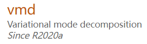
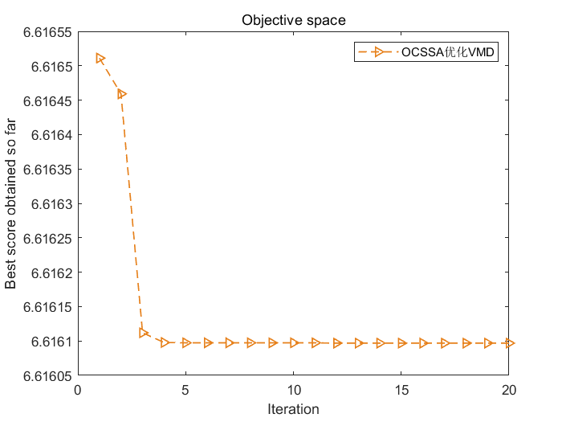
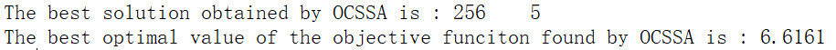
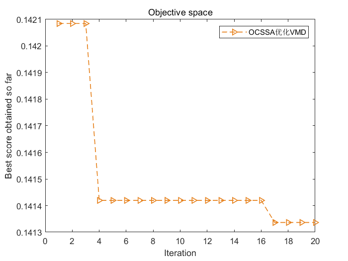
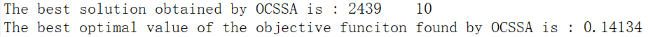
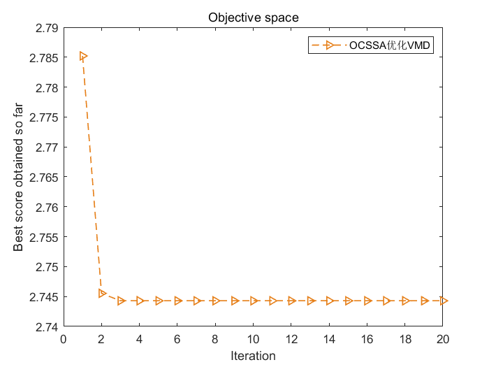
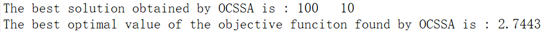
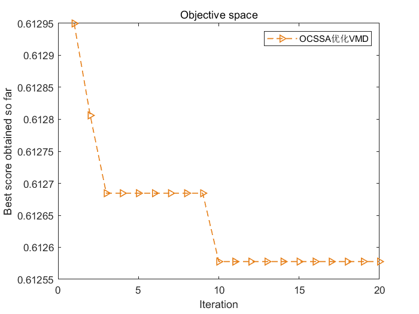
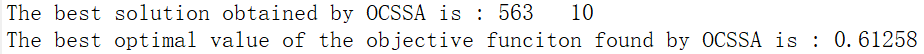
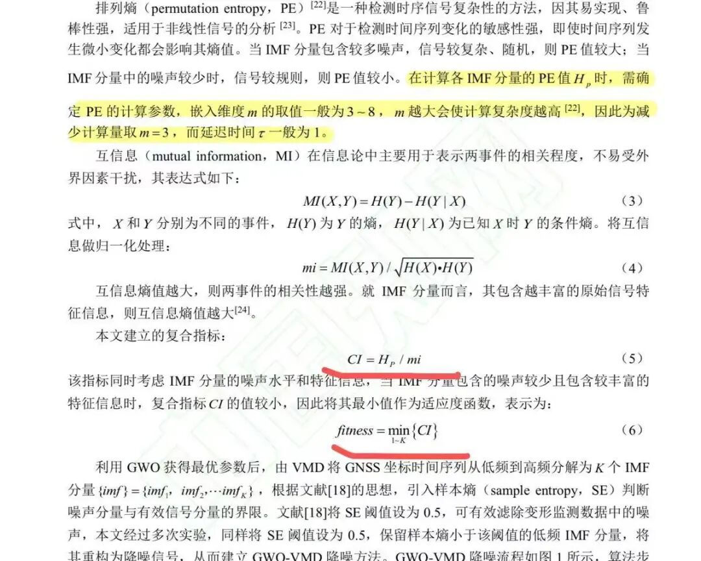
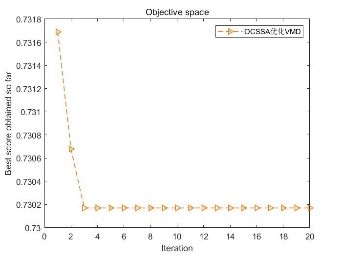
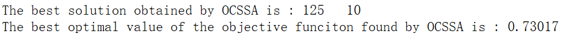
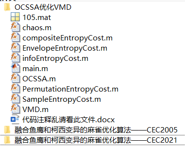

<!-- PAYMENT_BLOCK -->

## Get this dataset

- Payment link (Stripe): [Buy now](https://buy.stripe.com/3cs8yP7sY87d0vu9AB)
- Payment QR code: 

<!-- /PAYMENT_BLOCK -->
